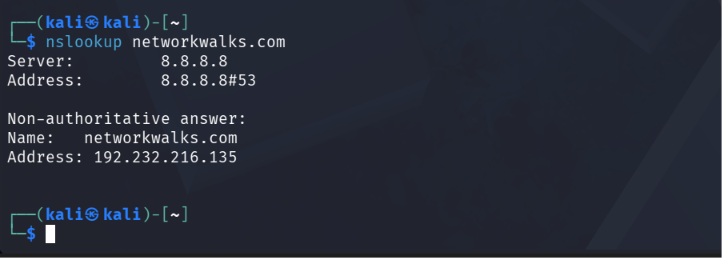
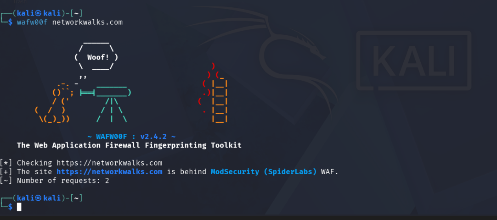

# Footprinting & Reconnaissance Using Kali Linux

**Module:** W2-PM1 — Week 2 Project Module 1  
**Author:** Shaik Mahboob Mohiuddin  
**Target:** `networkwalks.com` (training exercise)  
**Environment:** Kali Linux

## Overview
This project documents six introductory reconnaissance tasks performed for a cybersecurity and ethical hacking training module. The focus is collecting and interpreting publicly available domain, DNS, web technology, HTTP header, and WAF information. It does **not** demonstrate exploitation or a confirmed vulnerability.

## Tools and commands
| Tool | Command | Purpose |
|---|---|---|
| WHOIS | `whois networkwalks.com` | Domain registration and name servers |
| WhatWeb | `whatweb networkwalks.com` | Web technology fingerprinting |
| Nslookup | `nslookup networkwalks.com` | DNS address resolution |
| Curl | `curl -I https://networkwalks.com` | HTTP response headers |
| Wafw00f | `wafw00f networkwalks.com` | WAF fingerprinting |
| DNSRecon | `dnsrecon -d networkwalks.com` | DNS record enumeration |

## Key observations
- WHOIS identified GoDaddy as registrar and HostGator name servers.
- WhatWeb identified Apache, WordPress 7.1.4, and WordPress Download Manager 3.3.76.
- Nslookup resolved the domain to `192.232.216.135` at the time of the test.
- Curl returned HTTP/2 200 and WordPress REST API links.
- Wafw00f identified ModSecurity (SpiderLabs).
- DNSRecon returned name server, mail, address, TXT and SRV information.

These are **observations, not verified security vulnerabilities**. Results are time-dependent.

---

# WEEK 2 – FOOTPRINTING & RECONNAISSANCE

## Practical Screenshots – Kali Linux

### 1. WHOIS – Domain Information
.png)

### 2. WHOIS – Additional Registration Details
.png)

### 3. WhatWeb – Website Technology Detection

### 4. Nslookup – DNS Resolution

### 5. Curl – HTTP Response Headers

### 6. Wafw00f – WAF Detection

### 7. DNSRecon – DNS Enumeration

---

## Project Report

[View / Download W2-PM1 Penetration Testing Report](./REPORT%20WK2%20PM1.pdf)

## 📄 Project Report

**Footprinting & Reconnaissance Using Multiple Kali Linux Tools**

The complete project documentation is available below.

📥 [View / Download Project Report](./REPORT%20WK2%20PM1.pdf)

## Ethics and scope
For educational documentation only. Perform reconnaissance or further testing only within the authorization and scope established by the relevant system owner or training provider. No exploitation is documented here. Review permission to publish target-specific results before making this repository public.
